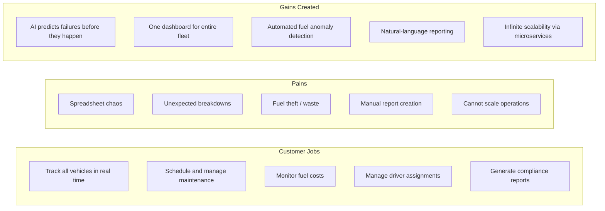
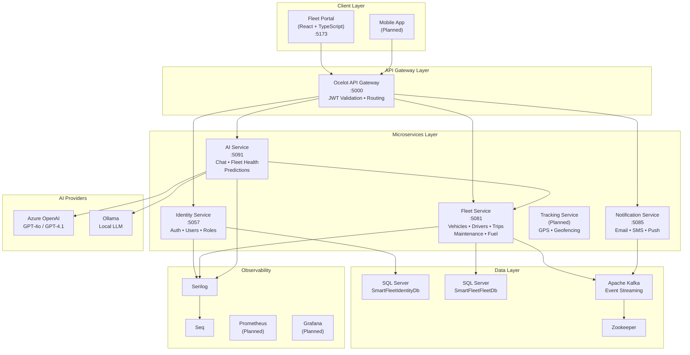
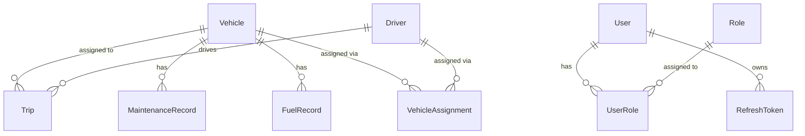
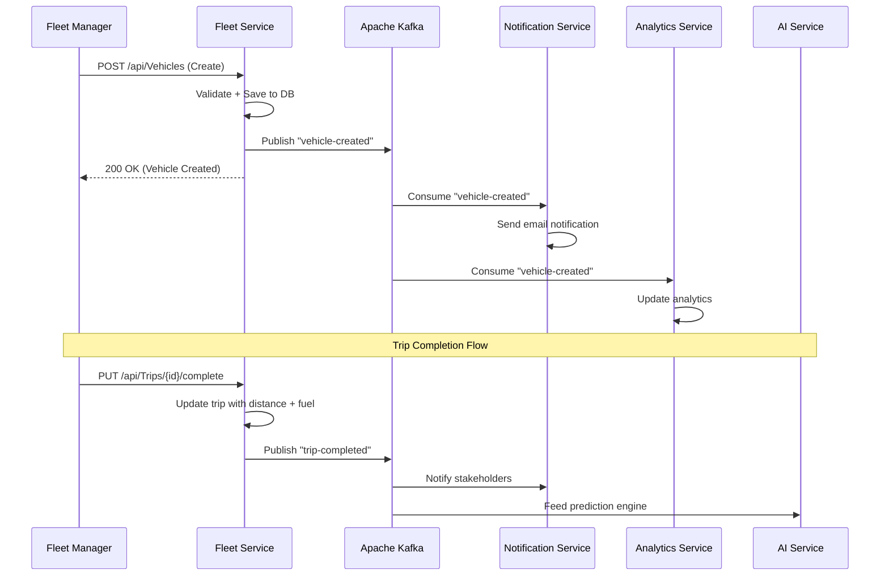

<
2. [Market Opportunity](#2-market-opportunity)
3. [Product Vision & Value Proposition](#3-product-vision--value-proposition)
4. [Platform Overview](#4-platform-overview)
5. [Core Business Modules](#5-core-business-modules)
6. [AI & Intelligence Layer](#6-ai--intelligence-layer)
7. [Technical Architecture](#7-technical-architecture)
8. [System Architecture Diagram](#8-system-architecture-diagram)
9. [Microservices Deep Dive](#9-microservices-deep-dive)
10. [Data Architecture](#10-data-architecture)
11. [Event-Driven Architecture](#11-event-driven-architecture)
12. [Security & Compliance](#12-security--compliance)
13. [Frontend & User Experience](#13-frontend--user-experience)
14. [Infrastructure & DevOps](#14-infrastructure--devops)
15. [Testing Strategy](#15-testing-strategy)
16. [API Design & Contracts](#16-api-design--contracts)
17. [Current Development Status](#17-current-development-status)
18. [Product Roadmap](#18-product-roadmap)
19. [Competitive Landscape](#19-competitive-landscape)
20. [Business Model & Revenue Streams](#20-business-model--revenue-streams)
21. [Go-To-Market Strategy](#21-go-to-market-strategy)
22. [Key Metrics & Success Criteria](#22-key-metrics--success-criteria)
23. [Risk Analysis & Mitigation](#23-risk-analysis--mitigation)
24. [Appendix](#24-appendix)

---

## 1. Executive Summary

**Smart Fleet Platform** is an enterprise-grade, AI-powered fleet management system that enables organizations to centralize and optimize their entire fleet operations — from vehicle tracking and driver management to predictive maintenance and fuel analytics — through a single, intelligent platform.

### The Problem

Organizations managing vehicle fleets face critical operational challenges:

| Challenge | Business Impact |
|---|---|
| Manual vehicle tracking | Lost visibility, delayed response times |
| Poor maintenance planning | 30-40% higher repair costs from reactive maintenance |
| Fuel misuse & inefficiency | 15-25% fuel waste from unoptimized routes |
| Fragmented legacy systems | Data silos, compliance risks, scaling limitations |
| No predictive insights | Missed cost-saving opportunities, unplanned downtime |
| Driver performance blind spots | Safety risks, liability exposure |

### The Solution

Smart Fleet Platform delivers a **cloud-native, microservices-based** platform with:

- **Real-time fleet visibility** across all vehicles, drivers, and trips
- **AI-powered intelligence** using Azure OpenAI (GPT-4o/4.1) and local LLM support for natural-language fleet queries, predictive maintenance, and optimization recommendations
- **Event-driven architecture** with Apache Kafka for real-time communication across all business domains
- **Enterprise-grade security** with JWT authentication, role-based access control (RBAC), and comprehensive audit logging
- **Production-ready infrastructure** with Docker containerization, Kubernetes-ready deployment, and CI/CD automation

### Key Differentiators

> [!IMPORTANT]
> What sets Smart Fleet Platform apart from incumbents:

1. **AI-Native Architecture** — Not a bolt-on; AI is woven into the platform's core, enabling natural-language fleet queries ("What is the fuel capacity of MH01AB1005?") with verified data grounding
2. **Modern Microservices** — Built from the ground up on .NET 10, CQRS/MediatR, and event-driven patterns — not a monolith with APIs bolted on
3. **Flexible LLM Strategy** — Supports both Azure OpenAI and local Ollama models, reducing vendor lock-in and enabling air-gapped deployments
4. **Enterprise Patterns** — Clean Architecture, Domain-Driven Design, and CQRS ensure the codebase scales with the business

---

## 2. Market Opportunity

### Global Fleet Management Market

```
┌─────────────────────────────────────────────────────┐
│  Market Size (2024):     $25.5 Billion              │
│  Projected (2030):       $52.4 Billion              │
│  CAGR:                   12.8%                      │
│  Key Driver:             IoT + AI Adoption           │
│  Fastest Growth:         Asia-Pacific (15.2% CAGR)   │
└─────────────────────────────────────────────────────┘
```

### Target Segments

| Segment | Fleet Size | Pain Points | Revenue Potential |
|---|---|---|---|
| **Logistics & Transportation** | 50 – 10,000+ vehicles | Route optimization, fuel waste, compliance | High |
| **Construction & Mining** | 20 – 500 vehicles | Equipment tracking, maintenance costs | High |
| **Field Services** | 10 – 200 vehicles | Driver scheduling, customer SLA adherence | Medium |
| **Government & Municipal** | 100 – 5,000+ vehicles | Budget control, utilization reporting | Medium |
| **Delivery & Last-Mile** | 50 – 2,000 vehicles | Real-time tracking, proof of delivery | High |

### Addressable Market

- **TAM** (Total Addressable Market): $52.4B globally by 2030
- **SAM** (Serviceable Addressable Market): $8.2B — mid-market enterprises in English-speaking markets
- **SOM** (Serviceable Obtainable Market): $120M — initial focus on India/MENA logistics and construction

---

## 3. Product Vision & Value Proposition

### Vision Statement

> *Modernize fleet operations with a scalable, AI-powered platform that transforms raw operational data into actionable intelligence — reducing costs, improving safety, and maximizing fleet utilization.*

### Value Proposition Canvas



### Quantified Customer Benefits

| Metric | Expected Improvement |
|---|---|
| Fleet downtime | **Reduced 25-40%** via predictive maintenance |
| Maintenance costs | **Reduced 20-30%** via proactive scheduling |
| Fuel costs | **Reduced 10-20%** via consumption analytics |
| Administrative time | **Reduced 50-60%** via centralized platform |
| Reporting time | **From hours to seconds** via AI assistant |
| Fleet utilization | **Increased 15-25%** via data-driven scheduling |

---

## 4. Platform Overview

### System Landscape

Smart Fleet Platform is composed of **6 microservices**, a **unified API Gateway**, and a **React-based frontend portal** — all orchestrated through event-driven messaging and containerized infrastructure.

```
┌──────────────────────────────────────────────────────────────────┐
│                     SMART FLEET PLATFORM                         │
├──────────────────────────────────────────────────────────────────┤
│                                                                  │
│  ┌──────────────────────────────────────────────────────────┐    │
│  │              FLEET PORTAL (React + TypeScript)            │    │
│  │     Dashboard │ Vehicles │ Drivers │ Trips │ AI Assistant │    │
│  └────────────────────────┬─────────────────────────────────┘    │
│                           │ HTTPS                                │
│  ┌────────────────────────▼─────────────────────────────────┐    │
│  │              API GATEWAY (Ocelot) — Port 5000             │    │
│  │      Centralized Routing │ JWT Validation │ Rate Limiting │    │
│  └────┬────────┬────────┬────────┬───────────┬──────────────┘    │
│       │        │        │        │           │                    │
│  ┌────▼───┐┌───▼────┐┌──▼───┐┌───▼───┐┌─────▼──────┐           │
│  │Identity││ Fleet  ││  AI  ││Notif. ││  Tracking  │           │
│  │Service ││Service ││Serv. ││Service││  Service   │           │
│  │ :5057  ││ :5081  ││:5091 ││ :5085 ││  (Planned) │           │
│  └───┬────┘└───┬────┘└──┬───┘└───┬───┘└────────────┘           │
│      │         │        │        │                               │
│  ┌───▼─────────▼────────▼────────▼──────────────────────────┐    │
│  │              INFRASTRUCTURE LAYER                         │    │
│  │  SQL Server 2022 │ Apache Kafka │ Zookeeper │ Serilog/Seq │    │
│  └──────────────────────────────────────────────────────────┘    │
│                                                                  │
└──────────────────────────────────────────────────────────────────┘
```

### Service Registry

| Service | Port | Technology | Status | Purpose |
|---|---|---|---|---|
| **API Gateway** | 5000 | Ocelot / .NET 10 | ✅ Running | Single entry point, JWT validation, routing |
| **Identity Service** | 5057 | ASP.NET Core / SQL Server | ✅ Running | Authentication, user management, RBAC |
| **Fleet Service** | 5081 | ASP.NET Core / SQL Server / Kafka | ✅ Running | Vehicles, drivers, trips, maintenance, fuel |
| **AI Service** | 5091 | ASP.NET Core / Azure OpenAI + Ollama | ✅ Running | AI assistant, fleet health analysis |
| **Notification Service** | 5085 | ASP.NET Core / SMTP / Twilio | ✅ Running | Email, SMS, in-app notifications |
| **Tracking Service** | — | Planned | 🔜 Planned | Real-time GPS, geofencing |
| **Analytics Service** | — | Planned | 🔜 Planned | BI reports, fleet intelligence |
| **Frontend Portal** | 5173 | React + TypeScript + Vite | ✅ Running | Fleet Manager dashboard and operations UI |

---

## 5. Core Business Modules

### 5.1 Vehicle Management

Complete lifecycle management for every vehicle in the fleet.

**Capabilities:**

| Feature | Description | Status |
|---|---|---|
| Vehicle Registration | Full CRUD with VIN, make, model, year, fuel type, capacity | ✅ Complete |
| Status Tracking | Active → InTrip → Maintenance → Inactive lifecycle | ✅ Complete |
| Vehicle Assignment | Assign/reassign/unassign drivers with full history tracking | ✅ Complete |
| Incident Management | Admin-only status change with automatic maintenance work order creation | ✅ Complete |
| Document Management | Insurance, registration, and inspection document tracking | 🔜 Planned |
| Kafka Events | `vehicle-created`, `vehicle-updated`, `vehicle-deleted`, `vehicle-driver-assignment-changed` | ✅ Complete |

**Business Logic Highlights:**
- Filtered unique database indexes enforce one active driver per vehicle and one active vehicle per driver
- Soft-deleting or deactivating an assigned driver automatically closes the active assignment
- Only `Admin` role can place a vehicle out of service and trigger unplanned maintenance work orders

---

### 5.2 Driver Management

End-to-end driver lifecycle from onboarding to performance tracking.

**Capabilities:**

| Feature | Description | Status |
|---|---|---|
| Driver Registry | Employee code, license info, contact, joining date | ✅ Complete |
| License Management | License number and expiry date tracking | ✅ Complete |
| Assignment Engine | One-to-one vehicle assignment with concurrency protection | ✅ Complete |
| Status Management | Active → Assigned → Inactive lifecycle | ✅ Complete |
| Performance Tracking | Trip efficiency, safety scoring | 🔜 Planned |

---

### 5.3 Trip Management

Full trip lifecycle with scheduling, execution tracking, and completion analytics.

**Capabilities:**

| Feature | Description | Status |
|---|---|---|
| Trip Scheduling | Source, destination, driver, vehicle, date range | ✅ Complete |
| Lifecycle Engine | Scheduled → InProgress → Completed (or Cancelled) | ✅ Complete |
| Completion Data | Actual distance, fuel consumed, timestamps | ✅ Complete |
| Validation Rules | Date validation, location validation, vehicle/driver availability checks | ✅ Complete |
| Kafka Events | `trip-created`, `trip-started`, `trip-completed`, `trip-cancelled` | ✅ Complete |

**Trip Domain Rules:**
```
Scheduled  ──[Start]──▸  InProgress  ──[Complete]──▸  Completed
     │                                                     
     └─────────[Cancel]──▸  Cancelled
```
- Trip creation validates existing vehicle-driver assignments
- Completion records actual end time, distance driven, and fuel consumed
- Only scheduled trips can be started or cancelled; only in-progress trips can be completed

---

### 5.4 Maintenance Management

Proactive maintenance scheduling with cost tracking and service history.

**Capabilities:**

| Feature | Description | Status |
|---|---|---|
| Maintenance CRUD | Schedule, update, complete, track all service records | ✅ Complete |
| Service Types | Oil change, tire rotation, brake service, inspection, etc. | ✅ Complete |
| Cost Tracking | Per-service cost recording and trend analysis | ✅ Complete |
| Vendor Management | Service provider tracking per maintenance record | ✅ Complete |
| Incident Work Orders | Automatic unplanned maintenance from Admin incidents | ✅ Complete |
| Kafka Events | `maintenance-created`, `maintenance-completed` | ✅ Complete |

---

### 5.5 Fuel Management

Comprehensive fuel tracking with efficiency analytics.

**Capabilities:**

| Feature | Description | Status |
|---|---|---|
| Fuel Log Entry | Vehicle, quantity, cost, odometer reading per fill | ✅ Complete |
| Efficiency Metrics | Mileage, cost per kilometer, average consumption | ✅ Complete |
| Trend Analysis | Monthly consumption and cost analysis charts | ✅ Complete |
| Anomaly Detection | Identify fuel inefficiencies and suggest improvements | 🔜 AI-Powered |

---

### 5.6 Dashboard & Reporting

Real-time operational visibility through KPIs, charts, and activity feeds.

**Dashboard KPIs:**
- Total Vehicles | Active Vehicles | Active Trips | Drivers Available | Maintenance Due

**Charts & Visualizations:**
- Fleet Utilization | Fuel Trends | Maintenance Cost | Trip Analytics

**Live Activity Feed:**
- Vehicle Created | Driver Assigned | Trip Started | Maintenance Completed

---

## 6. AI & Intelligence Layer

> [!TIP]
> **The AI layer is not a feature — it's a strategic differentiator.** Smart Fleet Platform embeds AI directly into operational workflows, enabling fleet managers to interact with their data conversationally.

### 6.1 Architecture

```
┌────────────────────────────────────────────────┐
│              AI SERVICE (:5091)                 │
│                                                 │
│  ┌──────────┐   ┌──────────────────────────┐   │
│  │ Chat     │   │ Fleet Vehicle Context    │   │
│  │ Endpoint │──▸│ Provider                 │   │
│  └─────┬────┘   │  • Extract registration  │   │
│        │        │  • Forward bearer token   │   │
│        │        │  • Query Fleet Service    │   │
│        │        │  • Inject verified data   │   │
│        │        └──────────────────────────┘   │
│        ▼                                        │
│  ┌──────────────────────────────────────────┐   │
│  │         LLM Provider Abstraction         │   │
│  │  ┌─────────────┐  ┌──────────────────┐  │   │
│  │  │ Azure OpenAI│  │ Ollama (Local)   │  │   │
│  │  │ GPT-4o/4.1  │  │ qwen3:0.6b       │  │   │
│  │  └─────────────┘  └──────────────────┘  │   │
│  └──────────────────────────────────────────┘   │
└────────────────────────────────────────────────┘
```

### 6.2 AI Capabilities

| Capability | Description | Status |
|---|---|---|
| **Fleet Chat Assistant** | Natural-language queries about any fleet data with verified, grounded answers | ✅ Live |
| **Data-Grounded Responses** | AI extracts vehicle registration numbers from questions, queries Fleet APIs with the user's auth token, and injects verified specs, maintenance history, and fuel records into the LLM context | ✅ Live |
| **Fleet Health Analysis** | Comprehensive fleet health assessment with risk scoring and recommendations | ✅ Live |
| **Predictive Maintenance** | Predict upcoming failures using historical maintenance and usage data | ✅ Backend Ready |
| **Natural Language Queries** | "Show vehicles needing maintenance" → structured data results | ✅ Backend Ready |
| **Route Optimization** | AI-generated optimal routes with ETA predictions | 🔜 Planned |
| **Driver Risk Scoring** | Behavioral analysis and safety scoring | 🔜 Planned |

### 6.3 Verified AI Interaction Example

```
User:   "What is the fuel capacity of MH01AB1005 vehicle registered in Smart Fleet system?"

System: 1. Extracts registration number "MH01AB1005" from the question
        2. Queries GET /fleet/Vehicles with user's JWT bearer token
        3. Finds matching vehicle specs in database
        4. Injects verified data: { FuelCapacity: 350, Make: "Tata", Model: "..." }
        5. Sends grounded context + question to LLM

AI:     "The fuel capacity of MH01AB1005 is 350 litres."
```

### 6.4 Multi-Provider LLM Strategy

| Provider | Model | Use Case | Status |
|---|---|---|---|
| **Ollama (Local)** | qwen3:0.6b | Development, air-gapped deployments, cost-sensitive environments | ✅ Default in Development |
| **Azure OpenAI** | GPT-4o, GPT-4.1 | Production, enterprise-grade accuracy | ✅ Available (config required) |

> This dual-provider strategy eliminates single-vendor lock-in and enables deployment in environments where external API access is restricted.

---

## 7. Technical Architecture

### 7.1 Architecture Principles

| Principle | Implementation |
|---|---|
| **Clean Architecture** | Domain → Application → Infrastructure → API layering in every service |
| **CQRS** | Commands and Queries separated via MediatR for clear read/write paths |
| **Domain-Driven Design** | Rich domain entities with business rules (e.g., Trip lifecycle state machine) |
| **Event-Driven Architecture** | Apache Kafka for asynchronous inter-service communication |
| **Repository Pattern** | Abstracted data access through repository interfaces |
| **API-First Design** | RESTful APIs with Swagger/OpenAPI documentation |
| **Database-per-Service** | Each microservice owns its database schema |

### 7.2 Technology Stack

#### Backend
| Technology | Version | Purpose |
|---|---|---|
| .NET | 10 | Runtime and SDK |
| ASP.NET Core | Latest | Web API framework |
| C# | Latest | Primary language |
| Entity Framework Core | Latest | ORM and migrations |
| MediatR | Latest | CQRS mediator |
| FluentValidation | Latest | Request validation |
| AutoMapper | 12.x | Object mapping |

#### Frontend
| Technology | Purpose |
|---|---|
| React 18 | UI framework |
| TypeScript | Type-safe JavaScript |
| Vite | Build tool and dev server |
| Redux Toolkit | State management |
| Material UI (MUI) | Component library |
| React Router | Client-side routing |
| Axios | HTTP client |
| Recharts | Data visualization |

#### Data & Messaging
| Technology | Purpose |
|---|---|
| SQL Server 2022 | Primary relational database |
| Apache Kafka | Event streaming and messaging |
| Zookeeper | Kafka coordination |

#### AI & ML
| Technology | Purpose |
|---|---|
| Azure OpenAI (GPT-4o/4.1) | Production LLM provider |
| Ollama | Local LLM provider for development |

#### Infrastructure
| Technology | Purpose |
|---|---|
| Docker + Docker Compose | Containerization |
| Ocelot | API Gateway |
| Serilog | Structured logging |
| Seq | Log aggregation and search |
| GitHub Actions | CI/CD automation |

---

## 8. System Architecture Diagram



---

## 9. Microservices Deep Dive

### 9.1 Identity Service

**Purpose:** Authentication, authorization, and user lifecycle management.

| Aspect | Detail |
|---|---|
| Port | 5057 |
| Database | SmartFleetIdentityDb |
| Auth Method | JWT Bearer Tokens |
| Access Token Validity | 60 minutes |
| Refresh Token Validity | 7 days |
| Password Hashing | ASP.NET Core PBKDF2 (salted) with SHA-256 legacy migration |

**Endpoints:**

| Method | Endpoint | Auth | Description |
|---|---|---|---|
| `POST` | `/api/Auth/register` | Public | Register a new user (assigned Dispatcher role) |
| `POST` | `/api/Auth/login` | Public | Authenticate and receive JWT + refresh token |
| `POST` | `/api/Auth/refresh-token` | Public | Refresh an expired access token |
| `GET` | `/api/Users` | Admin | List all users |
| `PUT` | `/api/Users/{id}/role` | Admin/SuperAdmin | Update a user's role |

**Role Hierarchy:**

| Role | Permissions |
|---|---|
| `SuperAdmin` | Platform-wide administration |
| `Admin` | Organization management, incidents, vehicle status changes |
| `FleetManager` | Vehicle CRUD, driver management, maintenance, fuel |
| `Dispatcher` | Trip creation, vehicle/driver assignment, monitoring |
| `MaintenanceTechnician` | Maintenance record management |
| `SafetyOfficer` | Safety reports, driver performance |
| `Viewer` | Read-only access |
| `Driver` | View assigned trips, update trip status |

---

### 9.2 Fleet Service

**Purpose:** Core fleet operations — the business engine of the platform.

| Aspect | Detail |
|---|---|
| Port | 5081 |
| Database | SmartFleetFleetDb |
| Architecture | Clean Architecture + CQRS + MediatR |
| ORM | Entity Framework Core |
| Validation | FluentValidation |
| Events | Apache Kafka producer + consumer |

**Project Structure (Clean Architecture):**

```
FleetService/
├── FleetService.API/            # Controllers, middleware, authorization
│   ├── Controllers/
│   │   ├── VehiclesController    # Vehicle CRUD + assignments + status
│   │   ├── DriversController     # Driver CRUD
│   │   ├── TripsController       # Trip lifecycle management
│   │   ├── MaintenanceRecordsController
│   │   ├── FuelRecordsController
│   │   └── DashboardController   # KPI aggregation
│   ├── Authorization/            # Role policies
│   └── Middleware/               # Global exception handling
├── FleetService.Application/    # CQRS handlers, DTOs, validation
│   ├── Features/
│   │   ├── Vehicles/             # Commands & Queries
│   │   ├── Drivers/
│   │   ├── FuelRecords/
│   │   ├── MaintenanceRecords/
│   │   └── Dashboard/
│   ├── DTOs/
│   ├── Validators/
│   └── Interfaces/
├── FleetService.Domain/         # Entities, enums, domain logic
│   └── Entities/
│       ├── Vehicle               # Fleet vehicle with status lifecycle
│       ├── Driver                # Driver profile and licensing
│       ├── Trip                  # Rich domain entity with state machine
│       ├── VehicleAssignment     # Vehicle-driver binding history
│       ├── MaintenanceRecord     # Service records and costs
│       └── FuelRecord            # Fuel consumption logs
├── FleetService.Infrastructure/ # EF Core, Kafka, repositories
│   ├── Persistence/              # DbContext, configurations
│   ├── Repositories/             # Repository implementations
│   ├── Messaging/                # Kafka producer/consumer
│   ├── Migrations/               # SQL Server migrations
│   └── Services/                 # Infrastructure services
└── FleetService.Tests/          # 38+ xUnit tests
```

**Key API Endpoints:**

| Method | Endpoint | Auth Role | Description |
|---|---|---|---|
| `GET` | `/api/Vehicles` | Any authenticated | List all vehicles |
| `GET` | `/api/Vehicles/{id}` | Any authenticated | Vehicle details |
| `POST` | `/api/Vehicles` | FleetManager+ | Create vehicle |
| `GET` | `/api/Vehicles/{id}/assignment` | Any authenticated | Current driver assignment |
| `PUT` | `/api/Vehicles/{id}/assignment` | FleetManager/Dispatcher | Assign/unassign driver |
| `PUT` | `/api/Vehicles/{id}/status` | Admin only | Change status + create incident work order |
| `GET` | `/api/Drivers` | Any authenticated | List all drivers |
| `POST` | `/api/Drivers` | FleetManager+ | Create driver |
| `GET` | `/api/Trips` | Any authenticated | List all trips |
| `POST` | `/api/Trips` | Dispatcher+ | Schedule a new trip |
| `PUT` | `/api/Trips/{id}/start` | Dispatcher+ | Start a scheduled trip |
| `PUT` | `/api/Trips/{id}/complete` | Dispatcher+ | Complete an active trip |
| `PUT` | `/api/Trips/{id}/cancel` | Dispatcher+ | Cancel a scheduled trip |
| `GET` | `/api/Dashboard/stats` | Any authenticated | Dashboard KPI aggregation |
| `GET` | `/api/MaintenanceRecords` | Any authenticated | All maintenance records |
| `GET` | `/api/FuelRecords` | Any authenticated | All fuel records |

---

### 9.3 AI Service

**Purpose:** Artificial intelligence layer providing conversational fleet intelligence and predictive analytics.

| Aspect | Detail |
|---|---|
| Port | 5091 |
| Architecture | Clean Architecture |
| LLM Providers | Azure OpenAI, Ollama |
| Fleet Integration | Real-time data grounding via Fleet Service APIs |

**Project Structure:**

```
AiService/
├── AiService.API/               # Controllers, configuration
│   └── Controllers/
│       └── AiAssistantController # Chat + Fleet Health endpoints
├── AiService.Application/       # Business logic, interfaces
│   ├── DTOs/                     # Request/response models
│   ├── Interfaces/               # IAiAssistantService, IFleetVehicleContextProvider
│   └── Services/                 # LLM orchestration
├── AiService.Domain/            # Domain models
├── AiService.Infrastructure/    # LLM provider implementations
└── AiService.Tests/             # 9 unit tests
```

**Key AI Endpoints:**

| Method | Endpoint | Description |
|---|---|---|
| `POST` | `/api/AiAssistant/chat` | Natural-language fleet queries with data grounding |
| `POST` | `/api/AiAssistant/fleet-health` | Fleet-wide health analysis and recommendations |
| `GET` | `/health` | AI service health check |

---

### 9.4 Notification Service

**Purpose:** Multi-channel notification delivery triggered by fleet events.

| Aspect | Detail |
|---|---|
| Port | 5085 |
| Channels | Email (SMTP), SMS (Twilio), In-App |
| Event Source | Apache Kafka consumer |
| Architecture | Provider abstraction with pluggable senders |

**Notification Triggers:**
- Maintenance due / overdue
- Vehicle offline or status change
- Fuel anomaly detected
- Geofence violation
- Driver behavior alert

---

## 10. Data Architecture

### 10.1 Database Strategy

The platform follows **Database-per-Service** architecture, ensuring service autonomy and independent scaling.

```
┌─────────────────────────────┐    ┌─────────────────────────────┐
│   SmartFleetIdentityDb      │    │     SmartFleetFleetDb       │
│                             │    │                             │
│   ┌─────────┐ ┌──────────┐ │    │   ┌──────────┐ ┌────────┐ │
│   │  Users  │ │  Roles   │ │    │   │ Vehicles │ │Drivers │ │
│   └─────────┘ └──────────┘ │    │   └──────────┘ └────────┘ │
│   ┌──────────┐ ┌─────────┐ │    │   ┌──────┐ ┌────────────┐ │
│   │UserRoles │ │Refresh  │ │    │   │Trips │ │Maintenance │ │
│   │          │ │ Tokens  │ │    │   │      │ │  Records   │ │
│   └──────────┘ └─────────┘ │    │   └──────┘ └────────────┘ │
│                             │    │   ┌──────────┐ ┌────────┐ │
│                             │    │   │  Fuel    │ │Vehicle │ │
│                             │    │   │ Records  │ │Assign. │ │
│                             │    │   └──────────┘ └────────┘ │
└─────────────────────────────┘    └─────────────────────────────┘
```

### 10.2 Core Audit Pattern

Every business entity includes a standardized audit trail:

```sql
Id            UNIQUEIDENTIFIER  PRIMARY KEY
CreatedBy     NVARCHAR(100)
CreatedOn     DATETIME2
ModifiedBy    NVARCHAR(100)
ModifiedOn    DATETIME2
IsDeleted     BIT               -- Soft delete support
```

### 10.3 Entity Relationships



### 10.4 Index Strategy

Performance-optimized indexes on high-query columns:

| Table | Indexes | Purpose |
|---|---|---|
| Vehicles | `IX_Vehicles_RegistrationNumber`, `IX_Vehicles_Status` | Fast lookup by reg number and status filter |
| Drivers | `IX_Drivers_LicenseNumber`, `IX_Drivers_Status` | License search and availability queries |
| Trips | `IX_Trips_Status`, `IX_Trips_StartDate`, `IX_Trips_VehicleId` | Trip filtering, scheduling, vehicle history |
| MaintenanceRecords | `IX_MaintenanceRecords_Status`, `IX_MaintenanceRecords_ScheduledDate` | Due/overdue maintenance queries |
| FuelRecords | `IX_FuelRecords_VehicleId`, `IX_FuelRecords_FuelDate` | Vehicle fuel history, trend analysis |
| AuditLogs | `IX_AuditLogs_ActionDate`, `IX_AuditLogs_UserId` | Compliance audit queries |

---

## 11. Event-Driven Architecture

### 11.1 Event Flow

Apache Kafka serves as the nervous system of the platform, enabling real-time, asynchronous communication between services.



### 11.2 Kafka Topics

| Topic | Producer | Consumers | Payload |
|---|---|---|---|
| `vehicle-created` | Fleet Service | Notification, Analytics | vehicleId, registrationNumber, vehicleType, createdAt |
| `vehicle-updated` | Fleet Service | Analytics | vehicleId, updatedAt |
| `vehicle-deleted` | Fleet Service | Analytics | vehicleId |
| `vehicle-driver-assignment-changed` | Fleet Service | Notification | vehicleId, driverId, action |
| `trip-created` | Fleet Service | Notification | tripId, source, destination |
| `trip-started` | Fleet Service | Tracking | tripId, vehicleId, driverId |
| `trip-completed` | Fleet Service | Analytics, AI | tripId, distance, fuelConsumed |
| `trip-cancelled` | Fleet Service | Notification | tripId, reason |
| `maintenance-created` | Fleet Service | Notification | vehicleId, serviceType, scheduledDate |
| `maintenance-completed` | Fleet Service | AI (predictions) | vehicleId, serviceType, cost |

---

## 12. Security & Compliance

### 12.1 Authentication Architecture

```
┌──────────────┐                    ┌─────────────────────┐
│   Client     │                    │  Identity Service   │
│              │    POST /login     │                     │
│              │──────────────────▸ │  1. Validate creds  │
│              │                    │  2. PBKDF2 hash     │
│              │  ◂──────────────── │  3. Generate JWT    │
│              │   JWT + Refresh    │  4. Return tokens   │
│              │                    └─────────────────────┘
│              │
│              │    GET /fleet/...  ┌─────────────────────┐
│              │──────────────────▸ │  API Gateway        │
│              │  Authorization:    │  1. Validate JWT    │
│              │  Bearer {token}    │  2. Check expiry    │
│              │                    │  3. Forward request │
│              │                    └─────────────────────┘
└──────────────┘
```

### 12.2 Security Features

| Feature | Implementation | Status |
|---|---|---|
| Password Hashing | PBKDF2 with salt (ASP.NET Core PasswordHasher) | ✅ Complete |
| Legacy Hash Migration | SHA-256 → PBKDF2 upgrade on next successful login | ✅ Complete |
| JWT Authentication | 60-minute access tokens, 7-day refresh tokens | ✅ Complete |
| Role-Based Access Control | 8 roles with granular endpoint authorization | ✅ Complete |
| HTTPS Enforcement | All API communication over TLS | ✅ Complete |
| Input Validation | FluentValidation on all API inputs | ✅ Complete |
| SQL Injection Protection | Parameterized queries via Entity Framework Core | ✅ Complete |
| Global Exception Handling | No stack traces leaked to clients | ✅ Complete |
| Audit Logging | User, action, timestamp, entity, old/new values | ✅ Complete |
| Soft Delete | No permanent data deletion; `IsDeleted` flag | ✅ Complete |
| Constant-Time Comparison | Legacy password hashes compared with constant-time algorithm | ✅ Complete |

### 12.3 RBAC Enforcement Matrix

| Endpoint | Admin | FleetManager | Dispatcher | Driver | Viewer |
|---|---|---|---|---|---|
| View Vehicles | ✅ | ✅ | ✅ | ✅ | ✅ |
| Create Vehicle | ✅ | ✅ | ❌ | ❌ | ❌ |
| Assign Driver | ✅ | ✅ | ✅ | ❌ | ❌ |
| Change Vehicle Status | ✅ | ❌ | ❌ | ❌ | ❌ |
| Schedule Trip | ✅ | ✅ | ✅ | ❌ | ❌ |
| Start/Complete Trip | ✅ | ✅ | ✅ | ❌ | ❌ |
| Manage Users | ✅ | ❌ | ❌ | ❌ | ❌ |

---

## 13. Frontend & User Experience

### 13.1 Design Philosophy

The UI is designed for **fleet managers and operations teams** who spend extended hours in the application. Key design principles:

- **Modern SaaS Dashboard** — Inspired by Azure Portal, Samsara, and Uber Fleet
- **Card-based layouts** with consistent spacing and clear visual hierarchy
- **Dark sidebar navigation** with 9 main sections
- **WCAG AA accessible** — keyboard navigation, proper contrast, screen reader support
- **Dark mode supported** — full dark/light theme switching
- **Responsive** — Mobile (0-767px), Tablet (768-1023px), Desktop (1024px+)

### 13.2 Design Tokens

| Token | Value | Usage |
|---|---|---|
| Primary | `#2563EB` (Blue) | Buttons, links, active navigation |
| Success | `#16A34A` (Green) | Active status, success messages |
| Warning | `#F59E0B` (Amber) | Maintenance due, warnings |
| Error | `#DC2626` (Red) | Errors, critical alerts |
| Background | `#F8FAFC` | Page background |
| Dark Background | `#0F172A` | Dark mode page background |
| Font | Inter → Segoe UI → Roboto | Primary typography |

### 13.3 Frontend Architecture

```
frontend/fleet-portal/src/
├── api/                     # API clients (Axios)
│   ├── apiClient.ts         # Configured Axios instance
│   ├── fleetApi.ts          # Fleet service API functions
│   ├── aiApi.ts             # AI assistant API functions
│   └── types.ts             # TypeScript interfaces
├── features/                # Feature-based modules
│   ├── auth/                # Login, Register pages
│   ├── dashboard/           # KPI cards, charts, activity feed
│   ├── vehicles/            # Vehicle list, detail, create
│   ├── drivers/             # Driver list, detail, create/edit
│   ├── maintenance/         # Maintenance dashboard and records
│   ├── fuel/                # Fuel dashboard and records
│   ├── ai-assistant/        # AI chat interface
│   └── profile/             # User profile management
├── components/              # Shared UI components
├── layouts/                 # App shell, sidebar, header
├── store.ts                 # Redux Toolkit store configuration
├── theme.ts                 # MUI theme with design tokens
└── App.tsx                  # Route configuration
```

### 13.4 Key UI Features

| Feature | Description | Status |
|---|---|---|
| **Global Search** | Search vehicles and drivers by name/registration, navigate to detail | ✅ Live |
| **Live Notifications** | Maintenance alerts and safety warnings from dashboard data | ✅ Live |
| **AI Chat Panel** | Right-side drawer with natural-language fleet queries | ✅ Live |
| **Vehicle Inventory Table** | Searchable, sortable data table with inline actions | ✅ Live |
| **Dashboard KPIs** | Real-time fleet statistics with charting | ✅ Live |
| **Secure Logout** | Clears credentials, auth headers, Redux state, redirects | ✅ Live |
| **Admin Incident Panel** | Status change + work order creation (Admin only) | ✅ Live |
| **Driver Assignment UI** | Assign/reassign drivers from vehicle detail page | ✅ Live |

---

## 14. Infrastructure & DevOps

### 14.1 Local Development Environment

All infrastructure runs via **Docker Compose** with a single command:

```powershell
.\run-all.ps1     # Starts Docker containers + all .NET services + React frontend
```

**Docker Containers:**

| Container | Image | Port | Purpose |
|---|---|---|---|
| `smartfleet-sqlserver` | mcr.microsoft.com/mssql/server:2022-latest | 1433 | Primary database |
| `smartfleet-kafka` | confluentinc/cp-kafka:7.5.0 | 9092 | Event streaming |
| `smartfleet-zookeeper` | confluentinc/cp-zookeeper:7.5.0 | 2181 | Kafka coordination |
| `smartfleet-kafka-ui` | provectuslabs/kafka-ui | 8080 | Kafka monitoring UI |

### 14.2 CI/CD Pipeline

**GitHub Actions** — Automated E2E smoke tests run daily and on manual dispatch:

```yaml
# .github/workflows/e2e.yml
Schedule: Daily at 06:00 UTC
Steps:
  1. Checkout code
  2. Run E2E script with authenticated endpoints
  3. Verify AI health, fleet API access, and data integrity
```

**Planned Azure DevOps Pipeline:**

```
Build → Unit Tests → Integration Tests → Security Scan → Docker Build → Deploy
```

**Quality Gates:**
- Build success
- All tests pass (currently 38+ Fleet, 9 AI, Notification)
- Security scan pass
- Code coverage > 80%

### 14.3 Production Deployment Architecture (Planned)

```
┌─────────────────────────────────────────────────────┐
│                    AZURE CLOUD                       │
│                                                      │
│  ┌─────────────────┐  ┌──────────────────────────┐  │
│  │  Azure Container │  │  Azure Kubernetes Service│  │
│  │  Registry (ACR)  │  │  (AKS)                   │  │
│  │                  │──▸│  Fleet Service Pod       │  │
│  │  Docker Images   │  │  Identity Service Pod    │  │
│  │                  │  │  AI Service Pod          │  │
│  │                  │  │  Notification Pod        │  │
│  │                  │  │  API Gateway Pod         │  │
│  └─────────────────┘  └──────────────────────────┘  │
│                                                      │
│  ┌──────────────┐  ┌──────────────┐  ┌────────────┐ │
│  │  Azure SQL   │  │ Azure OpenAI │  │   Azure    │ │
│  │  Managed     │  │  GPT-4o/4.1  │  │  Monitor   │ │
│  └──────────────┘  └──────────────┘  └────────────┘ │
└─────────────────────────────────────────────────────┘
```

---

## 15. Testing Strategy

### 15.1 Test Coverage

| Service | Framework | Tests | Coverage Areas |
|---|---|---|---|
| **FleetService.Tests** | xUnit + Moq + FluentAssertions | 38+ tests | Controller authorization metadata, role-based allow/deny, Trip lifecycle, assignment policies |
| **AiService.Tests** | xUnit | 9 tests | Chat/fleet-health with missing config, Ollama URL/model parsing, Azure deployment compatibility, authenticated vehicle context |
| **NotificationService.Tests** | xUnit | Unit + integration scaffold | Provider abstraction, event mapping |
| **E2E Smoke Tests** | PowerShell script | 7+ required checks | AI health, fleet vehicles, authenticated queries, AI data grounding |

### 15.2 Test Pyramid

```
        ╱╲
       ╱  ╲       E2E / Smoke Tests
      ╱ 7+ ╲      (scripts/e2e/run-e2e.ps1)
     ╱──────╲
    ╱        ╲     Integration Tests
   ╱  Planned ╲   (ASP.NET Core Test Host)
  ╱────────────╲
 ╱    47+ Unit  ╲  Unit Tests
╱    Tests      ╲ (xUnit + Moq + FluentAssertions)
╱────────────────╲
```

### 15.3 E2E Test Capabilities

The automated E2E script supports:
- Authenticated JSON POST requests
- Per-endpoint configurable timeouts
- Response-content assertions
- Auto-registration fallback for CI environments
- JWT acquisition from Identity Service

---

## 16. API Design & Contracts

### 16.1 Standardized Response Format

All APIs follow a consistent response envelope:

**Success Response:**
```json
{
  "success": true,
  "message": "Vehicle created successfully",
  "data": { /* entity or collection */ }
}
```

**Error Response:**
```json
{
  "success": false,
  "message": "Validation failed",
  "errors": ["Registration number is required"]
}
```

### 16.2 Gateway Routing

| Frontend Path | Gateway Route | Downstream Service |
|---|---|---|
| `/identity/*` | → `/api/*` | Identity Service (:5057) |
| `/fleet/*` | → `/api/*` | Fleet Service (:5081) |
| `/ai/*` | → `/api/*` | AI Service (:5091) |
| `/ai/health` | → `/health` | AI Service (:5091) |

### 16.3 Kafka Event Contract Example

```json
// VehicleCreatedEvent
{
  "vehicleId": 1,
  "registrationNumber": "MH01AB1234",
  "vehicleType": "Truck",
  "createdAt": "2026-01-01T10:00:00Z"
}

// TripCompletedEvent
{
  "tripId": 100,
  "distance": 350,
  "fuelConsumed": 40
}
```

---

## 17. Current Development Status

### 17.1 Overall Progress

```
Infrastructure           ████████████████████ 100%
Authentication           ████████████████████ 100%
Vehicle Management       ████████████████████ 100%
Driver Management        ████████████████████ 100%
Maintenance Management   ████████████████████ 100%
Fuel Management          ████████████████████ 100%
Kafka Foundation         ████████████████████ 100%
API Gateway              ████████████████████ 100%
Dashboard Stats API      ████████████████████ 100%
AI Service (Backend)     █████████████████░░░  85%
Notification Service     ███████████████░░░░░  75%
Frontend                 █████████████░░░░░░░  65%
Trip Management (UI)     ░░░░░░░░░░░░░░░░░░░░  0%
Cloud Deployment         ░░░░░░░░░░░░░░░░░░░░  0%
────────────────────────────────────────────────
OVERALL                  ████████████████░░░░  84%
```

### 17.2 Milestone Timeline

| Milestone | Target | Status |
|---|---|---|
| Backend core modules | Q2 2026 | ✅ Complete |
| Kafka event integration | Q2 2026 | ✅ Complete |
| API Gateway + Auth | Q2 2026 | ✅ Complete |
| AI Service (Ollama + Azure) | Q3 2026 | ✅ Complete |
| Frontend portal MVP | Q3 2026 | 🔄 In Progress (65%) |
| E2E testing framework | Q3 2026 | ✅ Complete |
| Role-based security hardening | Q4 2026 | ✅ Complete |
| Trip module (backend) | Q4 2026 | ✅ Complete |
| Trip UI + Driver mobile app | Q4 2026 | 🔜 Next |
| Cloud deployment (Azure AKS) | Q1 2027 | 🔜 Planned |
| Observability (Prometheus/Grafana) | Q1 2027 | 🔜 Planned |
| Production launch | Q1 2027 | 🔜 Planned |

---

## 18. Product Roadmap

### Phase 1: Foundation ✅ (Complete)
- Clean Architecture microservices setup
- Vehicle, Driver, Maintenance, Fuel CRUD
- SQL Server + Kafka + Docker infrastructure
- JWT authentication and RBAC
- Ocelot API Gateway
- Serilog structured logging

### Phase 2: Intelligence ✅ (Complete)
- AI Service with Azure OpenAI + Ollama
- Natural-language fleet queries with data grounding
- Fleet health analysis
- Real-time dashboard with KPIs and charts

### Phase 3: Current Sprint 🔄 (In Progress)
- Trip management UI
- Full integration testing
- Frontend polish and role-based UI controls
- Driver mobile experience

### Phase 4: Production Readiness 🔜 (Q1 2027)
- Kubernetes deployment manifests
- Azure AKS deployment
- Redis caching for hot data
- Prometheus + Grafana observability
- Load testing with k6
- Security audit (OWASP)

### Phase 5: Growth Features 🔮 (Q2 2027+)
- Real-time GPS tracking with geofencing
- Route optimization engine
- Predictive maintenance ML pipeline
- Driver scorecard and risk assessment
- Multi-tenant architecture
- Drag & drop trip planner
- Fleet heatmaps
- Mobile apps (iOS/Android)
- Marketplace integrations (ERP, fuel cards, telematics)

---

## 19. Competitive Landscape

### Market Positioning

| Feature | Smart Fleet | Samsara | Fleetio | Verizon Connect | Motive |
|---|---|---|---|---|---|
| AI Assistant (NL Queries) | ✅ | ❌ | ❌ | ❌ | ❌ |
| Predictive Maintenance | ✅ | ✅ | ⚠️ Basic | ❌ | ❌ |
| Microservices Architecture | ✅ | ❌ | ❌ | ❌ | ❌ |
| Event-Driven (Kafka) | ✅ | ❌ | ❌ | ❌ | ❌ |
| Open LLM Support | ✅ | ❌ | ❌ | ❌ | ❌ |
| Multi-Cloud Ready | ✅ | ❌ | ❌ | ❌ | ❌ |
| Self-Hosted Option | ✅ | ❌ | ❌ | ❌ | ❌ |
| Per-Seat Pricing | ✅ Planned | ❌ Per-Vehicle | ✅ | ❌ | ❌ |
| Air-Gapped Deployment | ✅ (Ollama) | ❌ | ❌ | ❌ | ❌ |

### Competitive Advantage

> [!NOTE]
> **Our moat is the combination of AI-native architecture + modern engineering + deployment flexibility.** Incumbents are monolithic SaaS platforms that cannot be self-hosted, don't support conversational AI, and charge per-vehicle (making them expensive at scale). Smart Fleet offers the same capabilities with a modern architecture that scales better and costs less.

---

## 20. Business Model & Revenue Streams

### Pricing Strategy

| Tier | Target | Fleet Size | Price | Features |
|---|---|---|---|---|
| **Starter** | Small fleets | 10-50 vehicles | $299/mo | Core modules, 5 users |
| **Professional** | Mid-market | 50-500 vehicles | $799/mo | All modules + AI assistant, 25 users |
| **Enterprise** | Large fleets | 500+ vehicles | Custom | Full platform, unlimited users, SLA, dedicated support |
| **Self-Hosted** | Government/Defense | Any | License fee | Air-gapped deployment, Ollama LLM |

### Revenue Streams

| Stream | Description | Margin |
|---|---|---|
| **SaaS Subscriptions** | Monthly/annual platform access | 80-85% |
| **AI Credits** | Pay-per-query for advanced AI analysis | 70-75% |
| **Professional Services** | Custom integrations, onboarding, training | 50-60% |
| **Marketplace** | Third-party integrations (telematics, fuel cards) | 30-40% |
| **Self-Hosted Licenses** | One-time license + annual maintenance | 75-80% |

---

## 21. Go-To-Market Strategy

### Phase 1: Establish (Q1-Q2 2027)
- **Target:** 10 pilot customers in India (logistics/construction)
- **Channel:** Direct sales + partner referrals
- **Goal:** Product-market fit validation, case study development

### Phase 2: Scale (Q3-Q4 2027)
- **Target:** 50 customers across India and MENA
- **Channel:** Channel partners, digital marketing, industry events
- **Goal:** $500K ARR

### Phase 3: Expand (2028)
- **Target:** 200+ customers, expand to Southeast Asia and Africa
- **Channel:** Strategic partnerships, marketplace presence
- **Goal:** $2M ARR

---

## 22. Key Metrics & Success Criteria

### Product Metrics

| Metric | Target |
|---|---|
| API response time | < 500ms (p95) |
| Platform uptime | 99.9% |
| Vehicles supported per instance | 10,000+ |
| Concurrent users | 1,000+ |
| Test coverage | > 80% |

### Business Impact Metrics

| Metric | Customer Target |
|---|---|
| Fleet downtime reduction | 25-40% |
| Maintenance cost reduction | 20-30% |
| Fuel cost reduction | 10-20% |
| Administrative time saved | 50-60% |
| Time-to-report reduction | 90%+ |

### Growth Metrics

| Metric | Year 1 Target |
|---|---|
| Paying customers | 50 |
| ARR (Annual Recurring Revenue) | $500K |
| NPS (Net Promoter Score) | > 50 |
| Monthly Active Users | 500+ |
| Customer retention rate | > 90% |

---

## 23. Risk Analysis & Mitigation

| Risk | Probability | Impact | Mitigation |
|---|---|---|---|
| **LLM accuracy for fleet queries** | Medium | High | Data grounding with verified fleet data; hallucination-proof by querying actual DB records |
| **Market timing** | Low | Medium | Fleet management is an established, growing market; AI adds differentiation |
| **Azure OpenAI cost scaling** | Medium | Medium | Ollama local LLM fallback reduces per-query cost; tiered AI credit pricing |
| **Enterprise sales cycle length** | High | Medium | Offer free pilot programs; focus on SMB-to-mid-market for faster adoption |
| **Data security concerns** | Medium | High | Self-hosted option with air-gapped LLM; SOC 2 compliance roadmap |
| **Scalability under load** | Low | High | Microservices + Kafka + Kubernetes; each service scales independently |
| **Competitive pressure** | Medium | Medium | AI-native + modern arch moat; incumbents would need full rewrite to match |

---

## 24. Appendix

### A. Service Port Map

| Service | Port | Protocol |
|---|---|---|
| Frontend (Vite Dev) | 5173 | HTTP |
| API Gateway (Ocelot) | 5000 | HTTP |
| Identity Service | 5057 | HTTP |
| Fleet Service | 5081 | HTTP |
| AI Service | 5091 | HTTP |
| Notification Service | 5085 | HTTP |
| SQL Server | 1433 | TCP |
| Apache Kafka | 9092 | TCP |
| Zookeeper | 2181 | TCP |
| Kafka UI | 8080 | HTTP |

### B. Quick Start

```powershell
# 1. Clone the repository
git clone https://github.com/syusuf444/smart-fleet-platform.git

# 2. Start Docker infrastructure
docker-compose up -d

# 3. Wait for Kafka and SQL Server (~20 seconds)

# 4. Start all services + frontend in one command
.\run-all.ps1

# 5. Open the Fleet Portal
# Browser → http://localhost:5173
```

### C. Repository Structure

```
smart-fleet-platform/
├── frontend/
│   └── fleet-portal/            # React + TypeScript + Vite
├── gateway/
│   └── ApiGateway/              # Ocelot API Gateway
├── services/
│   ├── fleet-service/           # Clean Architecture (5 projects)
│   ├── identity-service/        # JWT auth service
│   ├── ai-service/              # AI/LLM service (5 projects)
│   ├── notification-service/    # Multi-channel notifications (4 projects)
│   ├── tracking-service/        # (Planned) GPS tracking
│   └── analytics-service/       # (Planned) BI and reporting
├── shared/
│   ├── common-auth/             # Shared auth middleware
│   ├── common-logging/          # Shared Serilog config
│   ├── common-responses/        # Shared API response models
│   └── kafka/                   # Shared Kafka client
├── infrastructure/
│   ├── docker/                  # Dockerfiles
│   ├── kubernetes/              # K8s manifests (planned)
│   ├── terraform/               # IaC (planned)
│   └── scripts/                 # Infrastructure scripts
├── scripts/
│   └── e2e/                     # E2E smoke test suite
├── docs/
│   ├── MarkDowns/               # PRD, TechSpec, Schema, Design docs
│   └── UIUX-Design/            # UI/UX mockups and design system
├── docker-compose.yml           # Infrastructure containers
├── SmartFleetPlatform.slnx      # .NET solution file
└── run-all.ps1                  # One-command startup script
```

### D. Technology Decision Rationale

| Decision | Rationale |
|---|---|
| **.NET 10 over Node.js** | Type safety, performance, enterprise ecosystem, mature ORM (EF Core) |
| **CQRS + MediatR** | Clear separation of read/write concerns, testable handlers, pipeline behaviors |
| **Kafka over RabbitMQ** | Higher throughput, log-based replay, better for event sourcing patterns |
| **SQL Server over PostgreSQL** | Azure-native, enterprise licensing familiarity, strong EF Core tooling |
| **React + MUI over Angular** | Faster development, larger ecosystem, better developer experience |
| **Ocelot over YARP** | Simpler configuration, sufficient for current scale, easy to migrate later |
| **Ollama alongside Azure OpenAI** | Cost control, air-gapped deployments, vendor independence |

### E. Contact

**Project:** Smart Fleet Platform
**Repository:** [github.com/syusuf444/smart-fleet-platform](https://github.com/syusuf444/smart-fleet-platform)

---

<div align="center">

*This document is confidential and intended for potential investors and strategic partners.*
*Smart Fleet Platform — Intelligent Fleet Operations at Scale.*

**© 2026 Smart Fleet Platform. All Rights Reserved.**

</div>
]]>
